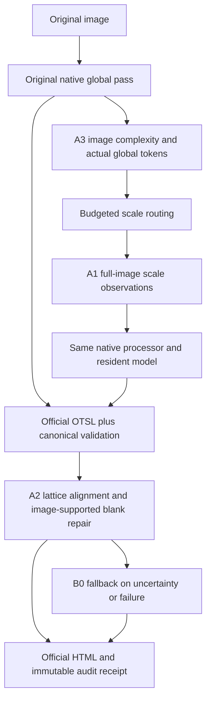

# SAMR architecture

SAMR adds a training-free upgrade path for Method A. It uses one injected
`XiaomiRuntime`, the original BF16 weights, original OTSL prompt and official serializer.
It has no optimizer, training data, gradient updates, LoRA or second model loader.
Historical A/B/C source and predictions are preserved.

`SAMRInferenceEngine.run(table_id, image)` has no ground-truth argument. The global
1.0 pass preserves the original input object. Single-scale development mode executes
only its requested factor and does not pretend an auxiliary-scale result is B0.
Fixed mode executes the specified list subject to budgets; ladder mode profiles the
candidate list; adaptive mode selects LOW/MEDIUM/HIGH using only image features and
the actual native global token count. The default does not execute every scale.

`ScaleLadder` plans isotropic PIL observations and predicts native sizes using the
existing audited helper. `XiaomiRuntime` still creates every input tensor through the
official processor. Each result is checked against its plan, prompt/model identity and
official HTML before becoming fusion evidence. Duplicate processed sizes are skipped.

`CanonicalTableGrid` uses the existing official parser, then validates rectangular
ownership, continuation tags and HTML topology. Unresolved structures remain recorded
and cannot force a repair. `align_grids` forms groups by intersecting occupied lattice
regions. Different row/column dimensions are unresolved; no ordinal cell matching is
performed. The current fusion policy permits only image-verified splits of declared
empty merged cells with unchanged text anchors. More general merge/text repairs remain
unsupported and retain B0.

The resource ledger reserves cumulative native visual tokens, including global and
failed attempts. The runtime checks actual tokens before generation against the smaller
of that reservation and the remaining budget. If global cannot fit, inference fails
before loading rather than silently exceeding the budget or inventing a baseline.
Deadlines stop admission and cooperatively stop decoding; native GPU forward passes
are nonpreemptible. See `complexity_routing_report.md` for the wall-time limitation.

Each immutable sample receipt contains the configuration identities, original and all
scale OTSL, actual resolutions/grids/tokens, canonical grids, feature contributions,
routing events, fusion evidence and final OTSL/HTML. Unexpected auxiliary or fusion
errors preserve B0; a failed first pass propagates because no valid B0 exists yet.
Completed samples are never overwritten. A new profile run requires a new directory.

Development inputs are limited to 32 images and checked against a pinned exclusion
manifest for the exact 665-table cohort. Matching image bytes or decoded RGB pixels,
including re-encoded table crops, are rejected. The engine never reads that manifest,
reference HTML, reference rows/columns or reference boxes. Optional scoring is a later
CPU process, using unchanged metric definitions.

This release does not execute a formal SAMR OmniDocBench evaluation. Historical A/B/C
evaluations are separate completed experiments. Smoke success establishes interface
and invariant checks, not an accuracy improvement.
